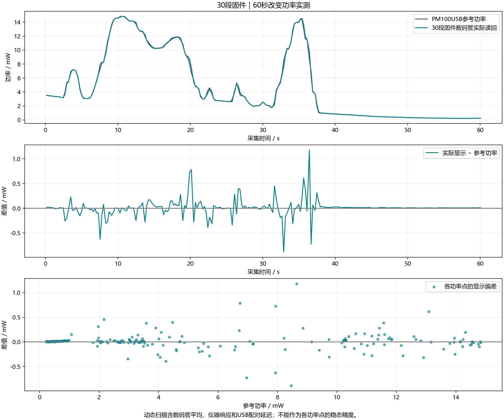

# 30段固件一分钟上板扫描报告

已JTAG下载。版本寄存器0x38=0x5030；数码管扫描帧直接读回；PI闭环未开启。本报告随30段版本归档。

60秒采集，251组有效、0组显示无效。
覆盖 0.226844–14.829448 mW。
平均偏差 +0.007830 mW；平均绝对误差 0.078447 mW；
RMSE 0.171914 mW；最大绝对差 1.179932 mW。

同一轮瞬时ADC对照：旧12段MAE=0.137233 mW，
新30段MAE=0.136636 mW。
这两项是公式对照，不是两份固件同一时刻分别运行的实测。

|参考功率范围 / mW|点数|实际显示平均偏差 / mW|平均绝对差 / mW|
|---|---:|---:|---:|
|0–1|96|+0.010138|0.010138|
|1–2|6|+0.079165|0.112271|
|2–5|67|+0.009660|0.072367|
|5–10|26|-0.033420|0.290770|
|10–15|56|+0.013195|0.100618|

动态扫描中的误差包含显示平均、功率计响应及USB配对延迟。没有用平移时间轴修饰误差。
如果本次没有覆盖1 mW以下，不能据此判断低功率改善。
旧标定数据的低功率部分有稀疏区间；30段拟合不能补足缺少的独立测量。

397组分段换算/边界/BCD检查通过；原PI、ADC、DAC回归通过。
Vivado BUILD_PASS，WNS +1.022 ns，WHS +0.058 ns。ADC/DAC外部时序约束沿用旧工程。

bit SHA256：`2d6fee1b50aa3bcf40d514f0547d46d8221bc20e27da871ed07603cbb0585feb`

## 1 mW以下细分

|功率范围/mW|点数|参考均值/mW|显示均值/mW|相对偏差|
|---|---:|---:|---:|---:|
|0–0.3|38|0.248855|0.255195|+2.547%|
|0.3–0.5|25|0.389632|0.397876|+2.116%|
|0.5–1|33|0.738011|0.753958|+2.161%|

结论：低功率动态读数仍存在约2%–2.5%正偏差，30段未消除该问题。不能继续仅靠增加分段数宣称改善，后续需要独立低功率标定与同步/响应核对。
